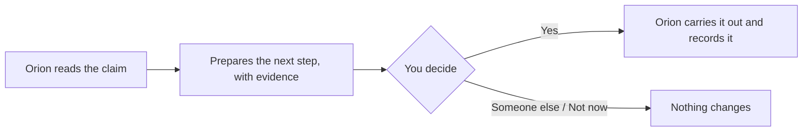

**Orion is your AI claims coworker.** It reads the claim, prepares the next safe step with
the evidence behind it, and waits for your yes. It never approves, rejects or pays a
claim — that decision is always yours.

## Signing in

Sign in with your Gooclaim work account — the same one you use for Portal — or with your
company's Microsoft or Google sign-in if your organisation uses it. If two-step
verification is on for your account, enter the 6-digit code from your authenticator app.

Two-step setup, recovery codes and password resets are done in Portal.

## Work Pulse

Orion opens on **Work Pulse**: the claims that need a person.

- **My work** — claims assigned to you.
- **Team queue** — your team's claims and unassigned ones (or every claim, if your role
  sees all claims).

Filter by **Review needed**, **Needs an owner**, **Assigned** and **Waiting on documents**,
or look back at **Completed this week**. Each claim shows why it needs a person, its owner,
its IRDAI deadline (days left, close, or passed) and the next action. The most urgent and
the closest to their deadline come first.

The line at the top shows what Gooclaim handled for your members in the last 7 days, and how
many conversations reached your team.

**Find a claim** (⌘K) searches by claim number, member or hospital, among the claims you
may open.

## Who can see what

| Your role can… | Typical roles |
|----------------|---------------|
| See your own claims | Everyone who works claims |
| See your team's claims | Tenant Admin, Claims Head, Team Lead, QA Auditor, Fraud Analyst, Grievance Officer |
| See every claim | Tenant Admin, Claims Head, QA Auditor, Fraud Analyst, Grievance Officer |
| Work on claims and ask Orion | Tenant Admin, Claims Head, Team Lead, Claims Processor, Medical Officer |
| Hand out work | Tenant Admin, Claims Head, Team Lead |
| Open member documents | Tenant Admin, Claims Head, Team Lead, Claims Processor, Medical Officer, QA Auditor, Fraud Analyst |

Opening a claim outside your own work is recorded, with the reason you could open it.

## Settings

**Settings** shows your account and access, your Orion use this month, your two-step
status, and theme and density. Tenant Admins and Claims Heads also see your organisation's
channels and whether the services Orion depends on are connected.
