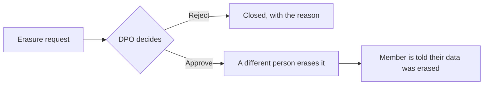

Open **Compliance**. Each tab needs its own permission.

## Grievance inbox

Member complaints arrive here with their deadline: claim complaints within **14 days**
(IRDAI) and personal-data complaints within **90 days** (DPDP).

- **Escalate** with a reason. The clock keeps running.
- **Resolve** with an outcome — Upheld, Partly upheld or Not upheld — and a note. If the
  complaint is not fully upheld, cite the policy clause.

Your note is sent to the member word for word, with the route to the Insurance Ombudsman.
Do not put names or health details in it.

## Data erasure requests

A member can ask for their data to be erased:

1. Your Data Protection Officer **approves** or **rejects** the request, with a reason.
   Approving deletes nothing yet.
2. A different person then **erases** it, after typing the request number. This cannot be
   undone.

Records the law requires you to keep are kept. The member is told when their data has been
erased.

## Consent records

The register of members' consent: when it was given, on which channel, its status and the
notice version. **Withdraw consent** records a withdrawal a member asked for by email,
phone or complaint; an email address and a phone number are two contacts, so give both to
withdraw both.

## IRDAI NL-48 (turnaround)

<Frame>
  
</Frame>

Pick a quarter and **Download CSV**. After the quarter ends, **File this quarter** freezes
the report as your kept copy; a quarter is filed once. Filing keeps a copy for you — it does
not send anything to IRDAI.

## Blocked members

A sender who asks about claim or policy numbers that do not exist — 3 in an hour, or 5 in a
week — is blocked, and nothing more is done for them. **Unblock** with a reason, which is
kept in the audit log.

## Audit log

Every automated decision Gooclaim OS makes for your organisation. Search and filter by date,
event type, actor, result and category, and open any event for its detail. **Download CSV**
exports everything in the range (the screen shows up to 1,000 events).

## Claim document retention

Under **Organisation → Organisation → Tenant profile → Claim documents**, set how many years
claim documents are kept, counted from a claim's last upload. **Legal hold** stops all
erasure; turning it on or off needs a reason. Only your own staff ever see these documents.
