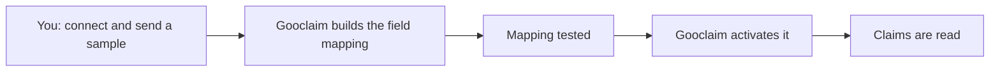

Open **Data & Connectors → Connectors**. There are two ways in: a **CMS connector** that
reads your claims system, and **Batch Dump** for files.

## CMS connectors

The list shows each connector, its field mapping (**Draft**, **Active** or **Paused**), its
health and its last successful fetch.

**Add CMS Connector** walks you through three steps:

1. **Connect.** Choose the connector type and enter your claims system's address and its
   **API key** — today Gooclaim OS signs in to a claims API with an API key only (see
   [Your claims API](/integration/claims-api)). For an SFTP server, press **Test
   connection**, check the server's fingerprint, and **Approve this server** before
   anything is read. If the server's identity later changes, nothing is read until you
   approve the new one.
2. **Sample data.** Upload or paste a sample of your records (CSV or JSON).
3. **Submit.** Your credentials are saved and your sample goes to the Gooclaim onboarding
   team, who build and test the field mapping.

The connector stays in **Draft** until Gooclaim activates its mapping. A record that does
not fit the mapping is never guessed at: it is stopped and reported.

<Note>To change a connector's address or credentials, contact your Gooclaim onboarding contact.</Note>

## Batch Dump (files)

Send member and claim files by SFTP, or upload them by hand.

- **By SFTP:** after setup, Gooclaim checks your server for new files every hour. See
  [Files and SFTP](/integration/files) for the folders and rules.
- **By hand:** choose the file type (**Members**, **Claims** or **Claim documents**) and a
  `.csv` or `.xlsx` file, press **Preview** to see what would be stored — nothing is saved
  yet — then **Looks right — ingest it**.

The **last sync** table shows each file and what happened to it: Synced, Mapped nothing to
store, Rejected, Store failed or Processing failed. Uploading a file that has already been
synced changes nothing.
