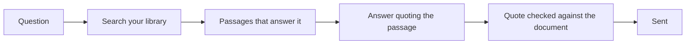

**Gooclaim Data Sources** is where you put the documents Gooclaim OS answers from: policy
wordings, claim manuals, FAQs, circulars and your own procedures. Members' questions about
cover are answered from them, and Orion searches them when your staff ask a question —
always quoting the passage it used.

## Opening it

In Portal, open **Data & Connectors → Data Sources** and press **Open Gooclaim Sources**.
It opens in a new tab and signs you in with your Portal session — there is no second
password.

You need permission to manage data sources; among the built-in roles, **Tenant Admin** and
**Integration Admin** have it.

## Two libraries

Every collection of documents belongs to one of two libraries. You choose when you create
the collection, and it cannot be changed later.

| Library | Who reads it | Put here |
|---------|--------------|----------|
| **Members** | Gooclaim OS, when it answers a member, and Orion | What a member may be told: policy wordings, member FAQs, published circulars |
| **Staff only** | Orion, for your claims staff — never a member's answer | Internal procedures, claim manuals, guidance not meant for members |

A file uploaded to a collection must match its library; a mismatch is refused. Other
organisations cannot see or search your libraries.

## Adding documents

**Upload files** into a collection:

- PDF, Word (`.doc`, `.docx`), PowerPoint (`.pptx`), text, Markdown, HTML, CSV or JSON.
- Up to 50 MB each; an empty file is refused.
- An uploaded file cannot yet be removed from the app — contact your Gooclaim contact if a
  file must be taken out.

**Or connect a source** your team already uses — more than 50 are available, for example
SharePoint, OneDrive, Google Drive, Confluence, Notion, Dropbox, Box, S3, Zendesk, Freshdesk
and ServiceNow. Your Gooclaim onboarding contact confirms
which sources are ready for your organisation. Credentials for a source are stored
encrypted.

## Keeping it up to date

- Each source is read again on the schedule you choose: once, hourly, daily, weekly,
  monthly or a custom schedule. Some sources — Google Drive and Gmail, for example — can
  update every few minutes.
- A new or changed document is picked up at the next read.
- A document removed from the source is removed at the next **full** read, not
  immediately. Full reads happen at least daily for sources that update every few minutes.

## How your documents are used

- **Search** finds passages by meaning and by keywords. Passages that do not actually answer
  the question are dropped, so the honest result can be "not found" — Gooclaim OS says so
  rather than guessing.
- **Answers to members** come only from the **Members** library. The answer must quote the
  passage it relies on; the quote is checked word for word against the document, every
  number in the answer must appear in the passage, and the answer must follow from it.
  Otherwise it is not sent.
- **Orion** shows your staff each passage it used, numbered, with the document, the library
  and the page. For an uploaded PDF, JPEG or PNG (up to 20 MB), staff can open the original
  from the citation.

## What to put where

- Keep one current version of each document; remove superseded wordings from the source so
  the next full read drops them.
- Put anything a member must not be told in a **Staff only** collection.
- Prefer the document itself (the policy wording PDF) over a summary of it: answers quote
  what is written.
