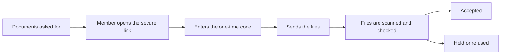

## Dashboard

<Frame>
  
</Frame>

- **Overview, last 30 days:** requests handled, handled automatically, needed a person, and
  workflows active, with a daily chart and the busiest workflows.
- **Needs attention:** complaints approaching their deadline and data requests waiting to
  be carried out.
- **Operational mode:** Operational, Restricted or Suspended.
- **Go-live status** while your organisation is being set up or tested. During testing,
  your Tenant Admin confirms here that the test conversations looked right.

## Performance

Choose 7, 30 or 90 days to see requests handled, how many were handled automatically and how
many needed a person, broken down by workflow with the average time.

### Document requests

When a claim waits on documents, members get a secure upload link. The funnel follows those
requests — asked, opened, sent a file, completed — and shows where members stopped: never
opened the link, could not pass the code, opened but sent nothing, still owe more files, or
a file is being checked, held or refused. Filter by channel, and see the open requests.

Files a member sends by email or WhatsApp instead of the link are not taken; the member is
sent the link.

## Usage

<Frame>
  
</Frame>

Usage shows counts and percentages, never money. Pick a date range, a channel, and day,
week or month.

- **Overview:** claims handled, answered without a person, member conversations and Orion
  questions, and where your AI use went.
- **Team** (administrators only): each person's Orion use. You can give each person a share
  of the monthly AI limit, with a default for everyone; Orion pauses for a person when their
  share is used, and starts again on the 1st.
- **AI limit:** how much of this month's limit is used, and where it is heading.
